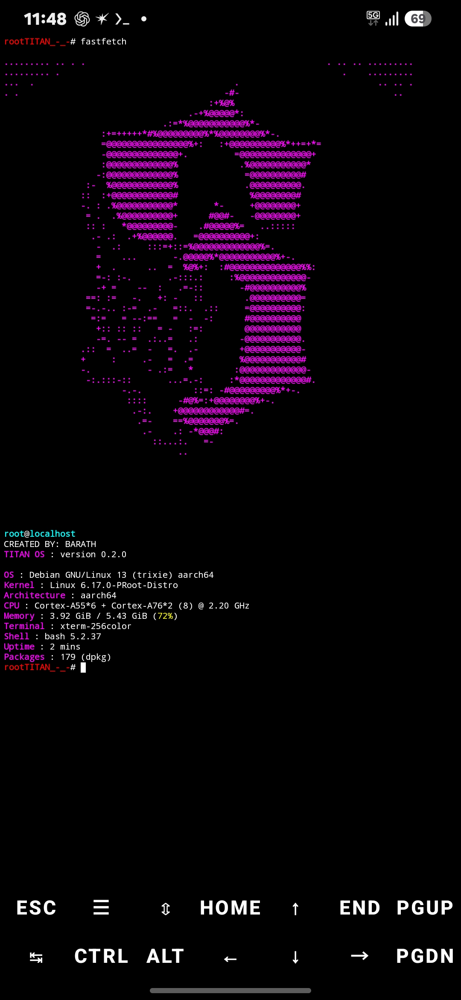

<div align="center">

# TITAN OS

### A powerful terminal-first Linux environment

**Built by BARATH**


[Download ZIP](https://github.com/Ffee2/TITAN-OS-/archive/refs/heads/master.zip) · [View Source](https://github.com/Ffee2/TITAN-OS-)

</div>

---

## Preview



---

## About TITAN OS

TITAN OS is a terminal-first Linux environment and system toolkit project designed to bring useful system tools, package management and diagnostics together.

### Features

| Component | Description |
|---|---|
| `ti` | TITAN package manager |
| `titan` | System diagnostics and monitoring |
| Native C Engine | System information engine |
| Fastfetch | Terminal appearance configuration |
| Android | Termux support |
| Debian | Debian 13 ARM64 development through PRoot |
| PC | Experimental Arch Linux installer |

---

## Download & Install

### Android — Termux

**Requirements:** Termux, Git, Clang and Make.

**1. Install required packages**

```bash
pkg update -y && pkg install git clang make -y
```

**2. Download TITAN OS**

```bash
git clone https://github.com/Ffee2/TITAN-OS-.git
```

**3. Enter the project folder**

```bash
cd TITAN-OS-
```

**4. Install TITAN tools**

```bash
bash install-android.sh
```

**5. Start TITAN OS tools**

```bash
ti doctor
titan info
```

Installation adds TITAN commands to Termux. It does not replace Android.

---

## Build Native Engine

From the project directory:

```bash
make
```

Run the native engine:

```bash
./build/titan-native help
```

---

## Available Commands

### Package manager

```bash
ti doctor
ti update
ti add PACKAGE
ti remove PACKAGE
```

### System tools

```bash
titan info
titan cpu
titan memory
titan storage
titan network
titan battery
```

---

## Platform Support

- **Android:** Termux command-line environment.
- **Debian:** Development through PRoot.
- **Arch Linux PC:** Experimental installer for supported Arch-based x86_64 systems.

> TITAN OS is currently a software and system-toolkit project, not a bootable independent operating system. A standalone bootable ISO is not available yet.

---

## 🛠️ Development

**Current version:** 0.2.0

TITAN OS is under active development. Features and platform support may change.

Contributions, testing and suggestions are welcome.

---

## Creator

**BARATH**

Created with curiosity, code and determination.

---

<div align="center">

### TITAN OS
**BUILD • EXPLORE • IMPROVE**

</div>

## Installation Requirements

See [REQUIREMENTS.md](REQUIREMENTS.md) for platform requirements and installation instructions.


---

## System Requirements

### Android (Termux)

**Minimum requirements**
- Android device with Termux installed
- Internet connection
- Git

**Optional development tools**
- Clang
- Make

Install dependencies:

```bash
pkg update -y && pkg install git clang make -y
```

Install TITAN OS:

```bash
git clone https://github.com/Ffee2/TITAN-OS-.git
cd TITAN-OS-
bash install-android.sh
```

### Arch Linux PC

**Requirements**
- Arch Linux or supported Arch-based distribution
- x86_64 architecture
- Root privileges
- Pacman and pacman-conf
- Configured repositories
- Internet connection

Install:

```bash
git clone https://github.com/Ffee2/TITAN-OS-.git
cd TITAN-OS-
sudo bash install-pc.sh
```

### Debian PRoot

Debian 13 ARM64 is a development environment. A dedicated Debian installer is not currently available.

**Important:** TITAN OS is currently a terminal-based software project, not a standalone bootable operating system. No bootable ISO is available yet.


## License

TITAN OS is licensed under the [MIT License](LICENSE). Copyright (c) 2026 BARATH.
